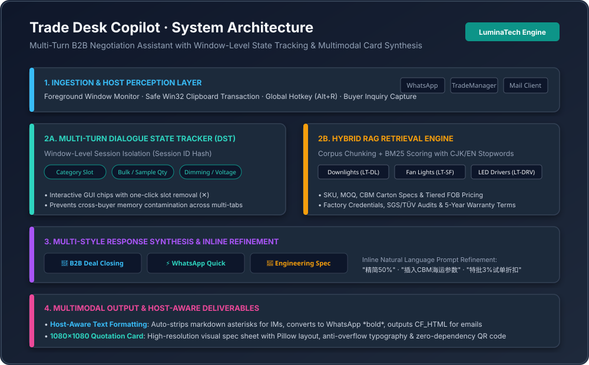
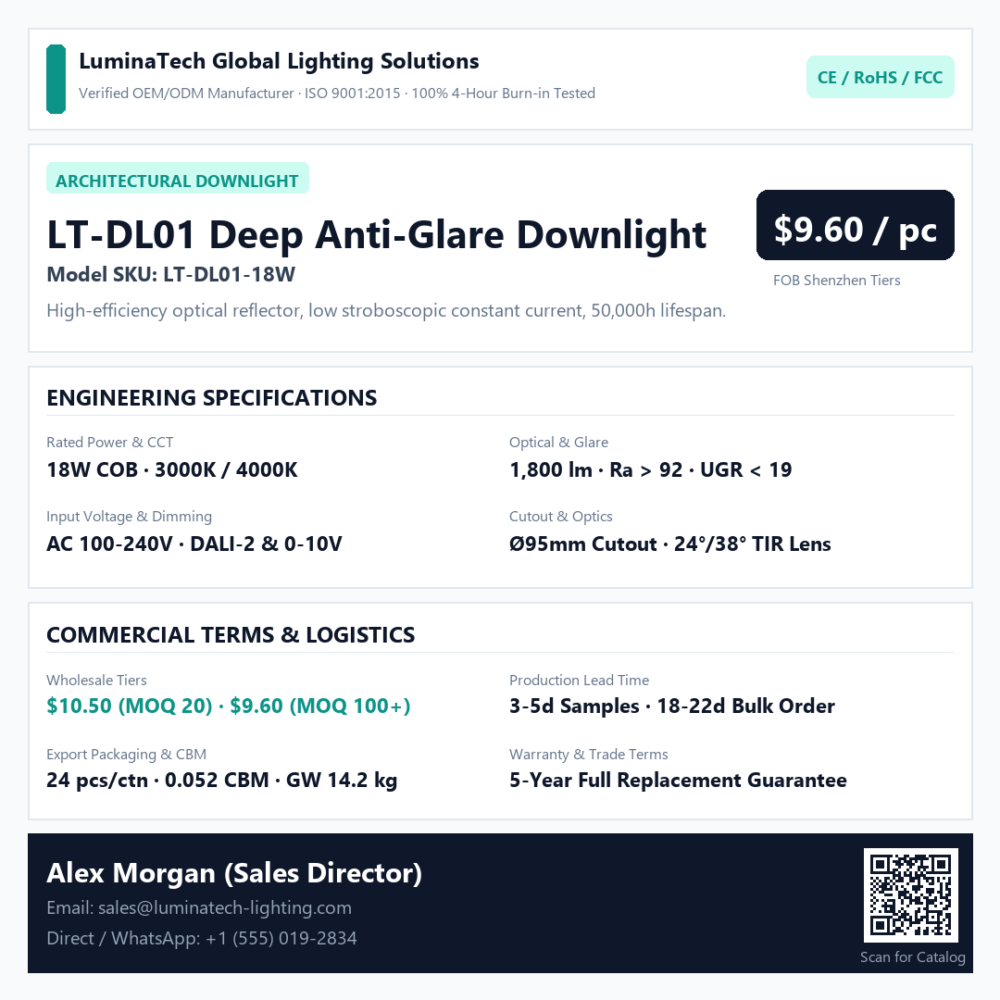

# Trade Desk Copilot · Intelligent B2B Foreign Trade Desktop Workbench

<div align="center">

[](LICENSE)
[](https://www.python.org/)
[]()
[](https://github.com/Daniel-24-life/AIfile)

**Lightweight Edge-Docked HUD Workbench for B2B Cross-Border Export Sales & Negotiation**  
Multi-Buyer Session Isolation · Interactive DST Slot Tracking · Real RAG Knowledge Injection · Host-Aware Clipboard Sanitization · 1080×1080 Visual Quotation Card Synthesis

[English](README.en.md) | [中文说明](README.md)

</div>

---

## 📌 Why Trade Desk Copilot?

B2B export sales professionals constantly juggle high-frequency conversations across disparate chat platforms (WhatsApp, Alibaba TradeManager, Outlook, WeChat). They face four major friction points:
- **Markdown Format Leaks**: Pasting raw LLM output into TradeManager or web forms leaves exposed `**bold**` asterisks, instantly revealing AI usage to buyers;
- **Cross-Buyer Memory Contamination**: When negotiating with multiple buyers simultaneously, hardware specs (e.g., ceiling fan voltages) from one tab bleed into architectural downlight tenders in another;
- **Catalog & Pricing Disconnect**: Sales reps must manually dig through offline Excel sheets to calculate carton CBM, sea freight pallet capacity, and tiered FOB pricing;
- **Slow Visual Quotation Creation**: Designing product quotation sheets via Photoshop or Canva takes 15–30 minutes, missing the critical 5-minute response window on WhatsApp.

**Trade Desk Copilot** docks unobtrusively on the edge of your screen, providing an instant HUD workflow: **Capture Inquiry → Intent Detection → Slot State Tracking → RAG Catalog Retrieval → Style & Prompt Refinement → Host Sanitization → 1080×1080 Visual Card Generation**.

---

## 🏛️ System Architecture



The system is organized into four clean layers:
1. **Host Perception & Ingestion Layer**: Monitors foreground window handles (TradeManager, WhatsApp Desktop, Outlook) to provide non-intrusive clipboard transactions and auto-hashes window handles for multi-buyer session isolation.
2. **Cognitive Core (DST & Hybrid RAG)**:
   - **Multi-Turn Dialogue State Tracker (DST)**: Extracts product category, bulk quantity, sample quantity, voltage, dimming protocol, and destination with lexical boundaries, allowing operators to click `✕` to discard individual slots;
   - **Lightweight Hybrid Retriever (BM25)**: Implements CJK/English stop-word filtration and field boosts (Title, SKU, Tags) to inject accurate specifications, CBM specs, and wholesale FOB tiers.
3. **Response Synthesis & Refinement Engine**:
   - Offers three distinct negotiation personalities: `[🌟 B2B Deal Closing]`, `[⚡ WhatsApp Quick]`, and `[📐 Engineering Spec]`;
   - Supports natural language inline refinement (e.g., `"offer $9.20 for 200 units"`, `"insert CBM container note"`).
4. **Multimodal Deliverable Layer**:
   - **Host-Aware Clipboard Sanitizer**: Strips asterisks for web IMs, converts to native `*bold*` for WhatsApp, and emits rich `CF_HTML` for email clients;
   - **1080×1080 Visual Quotation Card**: High-resolution Pillow rendering with anti-overflow typography and a **pure-Python zero-dependency QR code generator**.

---

## 🖼️ 1080×1080 Visual Quotation Card Sample

Generate square 1080×1080 high-resolution spec cards optimized for WhatsApp and TradeManager:

<div align="center">
  
</div>

---

## 🚀 Quick Start & Zero-API-Key Simulation

Trade Desk Copilot features a **dual-mode runtime**: an embedded offline simulation engine pre-loaded with 8 realistic B2B buyer scenarios allows **immediate out-of-the-box evaluation without API keys or active internet access**.

### 1. Installation
```bash
git clone https://github.com/Daniel-24-life/trade-desk-copilot.git
cd trade-desk-copilot
pip install -r requirements.txt
```

### 2. Interactive CLI Walkthrough
Run the terminal walkthrough across 8 realistic export scenarios (Dubai 5-star hotel tender, Amazon FBA trial order, European industrial driver inquiry, urgent DHL sample requests, price objections, etc.):
```bash
python run_demo.py
```

### 3. Launch Desktop Floating HUD Workbench (Windows)
Experience the sleek dark slate & teal desktop companion:
```bash
python run_demo.py --gui
```

### 4. Export High-Res Quotation Card
```bash
python run_demo.py --card
```

---

## 🧪 Automated Test Suite

Full test coverage across DST slot isolation, host formatting, BM25 retrieval, and 1080 card layout:

```bash
python -m pytest -c pytest.ini tests/ -v
```

```text
============================= test session starts =============================
tests/test_card_generator.py::test_pure_python_qr PASSED                [  7%]
tests/test_card_generator.py::test_card_generator PASSED                [ 14%]
tests/test_clipboard.py::test_strip_markdown_bold PASSED                [ 21%]
tests/test_clipboard.py::test_markdown_to_whatsapp PASSED              [ 28%]
tests/test_clipboard.py::test_host_aware_routing PASSED                 [ 35%]
tests/test_dst.py::test_dst_session_isolation PASSED                   [ 42%]
tests/test_dst.py::test_dst_slot_removal PASSED                        [ 50%]
tests/test_dst.py::test_dst_quantity_discrimination PASSED             [ 57%]
tests/test_pipeline.py::test_agent_pipeline_end_to_end PASSED          [ 64%]
tests/test_pipeline.py::test_agent_styles PASSED                       [ 71%]
tests/test_pipeline.py::test_inline_refinement PASSED                  [ 78%]
tests/test_pipeline.py::test_sanitization_zero_leakage PASSED          [ 85%]
tests/test_retriever.py::test_corpus_loader PASSED                     [ 92%]
tests/test_retriever.py::test_hybrid_retriever PASSED                  [100%]
============================= 14 passed in 0.18s ==============================
```

---

## 🛡️ Synthetic Data & Sanitization Disclosure

All demonstration materials, enterprise profiles, product models, and contact information are **100% synthetic mock data**:
- Virtual Brand: `LuminaTech Global Lighting Solutions Ltd.`
- Sales Representative: `Alex Morgan (Sales Director)`
- Pricing: Generalized FOB wholesale benchmarks without proprietary factory cost matrices.

---

## 🔗 Related Works & Ecosystem
- **Portfolio Showcase**: [AIfile Portfolio Showcase (#13)](https://github.com/Daniel-24-life/AIfile)
- **Developer Profile**: [Daniel-24-life](https://github.com/Daniel-24-life)
- **Pre-Sales Companion**: [buyer-research-agent (Lead Qualification & Research Agent)](https://github.com/Daniel-24-life/buyer-research-agent)
