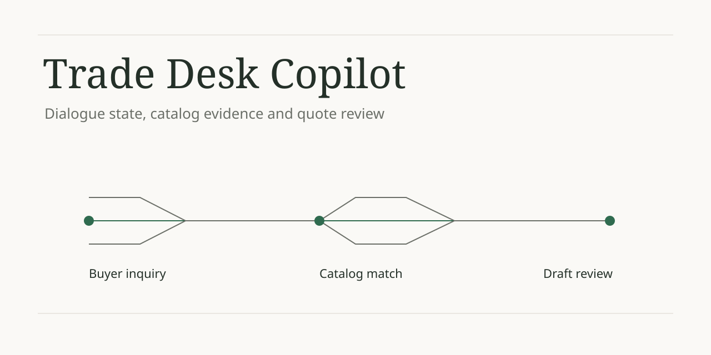
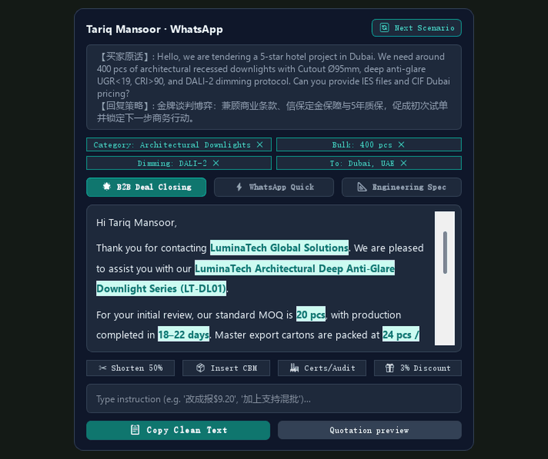
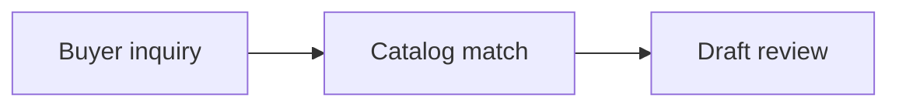

<picture>
  <source media="(prefers-color-scheme: dark)" srcset="docs/cover-dark.svg" />
  <source media="(prefers-color-scheme: light)" srcset="docs/cover-light.svg" />
  
</picture>

# Trade Desk Copilot

Track an inquiry across turns, find relevant catalog evidence, and prepare a quote for human review.

[▶ Demo](#demo) · [中文](README.zh.md) · [](https://github.com/Daniel-24-life/trade-desk-copilot/actions/workflows/ci.yml) · [MIT](LICENSE) · Python 3.10+

## Demo



The desktop demo inspects a hotel inquiry, removes the dimming requirement with the keyboard, then opens the catalog review for a fan-light inquiry.

## Problem

Inquiry details often arrive in fragments. A reviewer needs to see which requirements are on record, which products support the reply, and which fields still need checking.

## What I built

- Track buyer requirements as the conversation evolves.
- Retrieve the matching catalog entries for a reply draft.
- Show the draft to an operator before it is used.
- Render a quotation card from the demo catalog.

## How it works



## Run in 60 seconds

```sh
python -m pip install -r requirements.txt
python run_demo.py --gui
```

Remove the dimming slot in the first inquiry, choose **Next Scenario**, and open **Quotation preview** for the second inquiry.

Run `python run_demo.py` for the terminal walkthrough or `python run_demo.py --card` to export the standalone sample card.

## Tests

**22 tests passed on Windows.** [GitHub Actions workflow](https://github.com/Daniel-24-life/trade-desk-copilot/actions/workflows/ci.yml).

```sh
python -m pytest tests -q
```

## Repository layout

| Path | Contents |
| --- | --- |
| [`app/`](app/) | PyQt5 desktop workbench |
| [`core/`](core/) | Dialogue state, retrieval and quote rendering |
| [`corpus/`](corpus/) | Catalog and company fixtures |
| [`tests/`](tests/) | Inquiry, retrieval and card checks |

Reference material · [architecture_overview.svg](assets/screenshots/architecture_overview.svg)

<sub>Demo data is synthetic; modeled on real-world workflows. The desktop workbench uses fixture-driven responses, and quote cards carry no commercial commitment.</sub>
