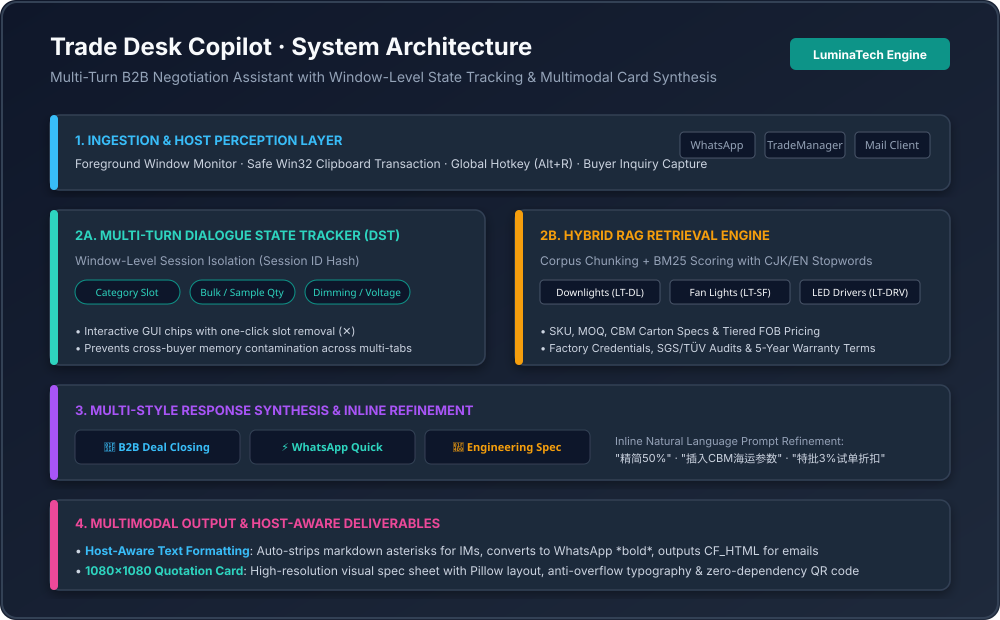

# Trade Desk Copilot · 外贸桌面智能协作助手

<div align="center">

[](LICENSE)
[](https://www.python.org/)
[]()
[](https://github.com/Daniel-24-life/AIfile)

**面向 B2B 出海商务与外贸业务员的轻量级桌面 HUD 协作工作台**
多买家会话隔离 · 交互式 DST 槽位追踪 · 真实知识库 RAG 注入 · 宿主感知剪贴板清洗 · 1080×1080 视觉报价卡生成

[English](README.en.md) | [中文说明](README.md)

</div>

---

## 📌 为什么需要 Trade Desk Copilot？

外贸业务员与海外采购商洽谈时，面临高频的**多平台窗口穿梭**与**繁重信息检索**：
- **格式穿帮**：直接复制 LLM 生成的 Markdown 文本进千牛或网页端，残留大量裸露的 `**` 星号，买家一眼看穿；
- **跨买家记忆污染**：多窗口同时洽谈时，上一个买家的品类（如风扇灯）很容易污染下一个买家的工程筒灯谈判；
- **出厂成本与报价脱节**：业务员必须频繁翻找 Excel 底价表、外箱尺寸并手算装箱 CBM 与阶梯价格；
- **促单卡片制作低效**：临时使用 Photoshop 或在线工具作图排期耗时，错失 WhatsApp 黄金沟通窗口（3–5 分钟内）。

**Trade Desk Copilot** 常驻桌面屏幕边缘，提供极简 HUD 悬浮交互，实现从“捕获询盘 → 意图识别 → 槽位跟踪 → 知识库检索 → 风格微调 → 宿主格式清洗 → 1080×1080 高清报价卡”的完整闭环。

---

## 🏛️ 系统架构 (System Architecture)



系统由四大分层协同构成：
1. **宿主感知与捕获层 (Ingestion & Perception)**：通过 Win32 窗口句柄识别当前活跃聊天客户端（千牛、阿里国际站、WhatsApp Desktop、Outlook），实现无感剪贴板事务处理与多买家会话 ID 哈希分桶。
2. **认知核心层 (DST & Hybrid RAG)**：
   - **多轮状态跟踪器 (DST)**：词法隔离抽取品类、大货量、样品量、电压、调光协议与目的国，支持界面一键剔除胶囊槽位（`✕`）；
   - **轻量混合检索器 (BM25)**：中英文外贸停用词过滤与字段加权召回，精准匹配对应 SKU、箱规 CBM 与 FOB 批发梯阶报价。
3. **响应合成与微调引擎 (Synthesis & Refinement)**：
   - 内置三大谈判风格：`[🌟 金牌谈判博弈]`、`[⚡ WhatsApp极简短句]`、`[📐 工程技术详单]`；
   - 支持自然语言单行指令微调（如：`"改成200台报$9.20"`、`"加上CBM海运参数"`）。
4. **多模态交付层 (Multimodal Outputs)**：
   - **宿主感知清洗**：自动剔除 IM 裸星号、转换 WhatsApp 原生单星号、输出邮件 HTML 富文本；
   - **1080×1080 视觉报价卡**：Pillow 像素级动态排版防溢出，集成**纯 Python 零依赖二维码生成引擎**。

---

## 🖼️ 1080×1080 视觉报价卡样例

系统支持一键生成正方形 1080×1080 高分辨率商业报价卡，适配 WhatsApp / 旺旺原图发送：

<div align="center">
  
</div>

---

## 🚀 快速上手与运行体验

项目采用**双模设计**：内置全套离线模拟引擎与 8 个典型出海询盘场景，**无需任何 API 密钥或外部网络依赖即可开箱即用**。

### 1. 安装依赖
```bash
git clone https://github.com/Daniel-24-life/trade-desk-copilot.git
cd trade-desk-copilot
pip install -r requirements.txt
```

### 2. 交互式终端仿真 (Terminal Simulation)
无需 GUI 环境，在任何终端均可完整体验 8 个真实出海场景（中东酒店大单、美亚 FBA 选品、欧洲驱动采购、急件打样、价格异议攻防等）：
```bash
python run_demo.py
```

### 3. 启动桌面浮动 HUD 工作台 (Desktop GUI)
在 Windows 环境下唤起常驻桌面的 HUD 悬浮工作台，体验胶囊交互与视觉卡片生成：
```bash
python run_demo.py --gui
```

### 4. 导出高清报价卡
```bash
python run_demo.py --card
```

---

## 🧪 自动化测试验证

全套测试覆盖 DST 状态隔离、多应用格式清洗、知识库检索与 1080 报价卡渲染：

```bash
python -m pytest -c pytest.ini tests/ -v
```

```text
============================= test session starts =============================
tests/test_card_generator.py::test_pure_python_qr PASSED                [  7%]
tests/test_card_generator.py::test_card_generator PASSED                [ 14%]
tests/test_clipboard.py::test_strip_markdown_bold PASSED                [ 21%]
tests/test_clipboard.py::test_markdown_to_whatsapp PASSED              [ 28%]
tests/test_clipboard.py::test_host_aware_routing PASSED                 [ 35%]
tests/test_dst.py::test_dst_session_isolation PASSED                   [ 42%]
tests/test_dst.py::test_dst_slot_removal PASSED                        [ 50%]
tests/test_dst.py::test_dst_quantity_discrimination PASSED             [ 57%]
tests/test_pipeline.py::test_agent_pipeline_end_to_end PASSED          [ 64%]
tests/test_pipeline.py::test_agent_styles PASSED                       [ 71%]
tests/test_pipeline.py::test_inline_refinement PASSED                  [ 78%]
tests/test_pipeline.py::test_sanitization_zero_leakage PASSED          [ 85%]
tests/test_retriever.py::test_corpus_loader PASSED                     [ 92%]
tests/test_retriever.py::test_hybrid_retriever PASSED                  [100%]
============================= 14 passed in 0.18s ==============================
```

---

## 🛡️ 数据脱敏与合规声明

本项目所有演示数据、企业档案与商品参数均为**合成虚拟数据 (Synthetic Mock Data)**：
- 虚拟企业：`LuminaTech Global Lighting Solutions Ltd.`
- 虚拟联系人：`Alex Morgan (Sales Director)`
- 虚拟价格：基于行业通用经验估算的 FOB 美金批发梯度，不含任何特定企业的真实私密成本底价与客户隐私。

---

## 🔗 相关链接与作品集
- **AIfile 作品集目录**：[AIfile Portfolio (#13)](https://github.com/Daniel-24-life/AIfile)
- **开发者个人主页**：[Daniel-24-life](https://github.com/Daniel-24-life)
- **互补项目**：[buyer-research-agent (售前潜客深度调研 Agent)](https://github.com/Daniel-24-life/buyer-research-agent)
