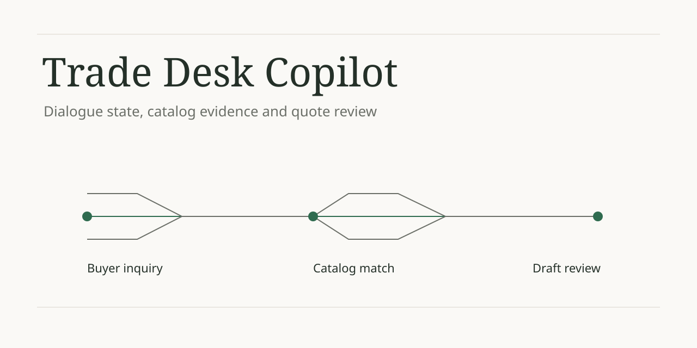
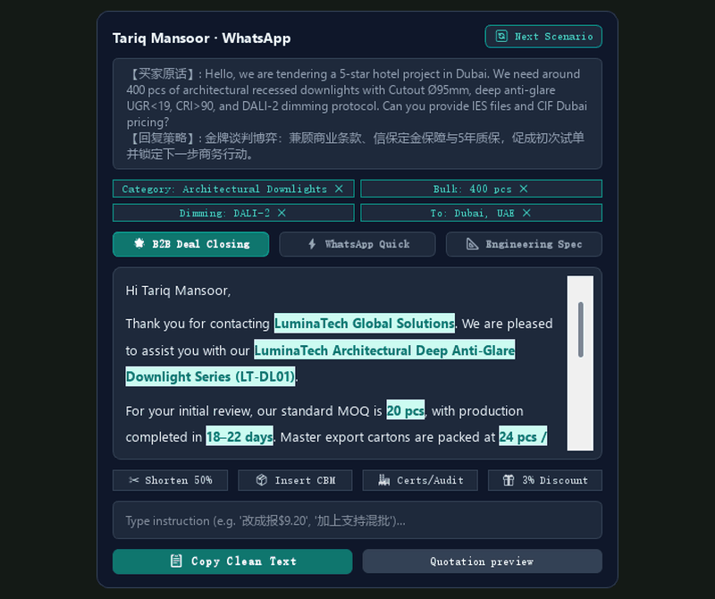
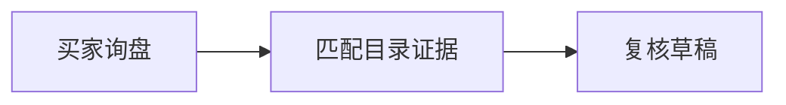

<picture>
  <source media="(prefers-color-scheme: dark)" srcset="docs/cover-dark.svg" />
  <source media="(prefers-color-scheme: light)" srcset="docs/cover-light.svg" />
  
</picture>

# 外贸询盘工作台

把分散在多轮对话中的需求整理成可检查的回复草稿与报价卡。

[查看演示](#demo) · [English](README.md) · [](https://github.com/Daniel-24-life/trade-desk-copilot/actions/workflows/ci.yml) · [MIT](LICENSE) · Python 3.10+

## Demo



桌面演示依次展示查看酒店询盘、按空格移除调光字段、切换到风扇灯询盘，以及打开目录报价复核。

## 要解决的问题

询盘往往分多轮补充。复核人需要同时看到已确认需求、待补字段和为回复提供支撑的目录条目。

## 实现

- 跟踪买家需求和待补充字段。
- 检索商品目录，为回复提供依据。
- 让操作员检查草稿并导出报价卡。

## 工作流程



## 快速运行

```sh
python -m pip install -r requirements.txt
python run_demo.py --gui
```

打开桌面窗口后，在首条询盘移除调光字段。点 **Next Scenario** 切换到第二条，再打开 **Quotation preview**。

也可运行 `python run_demo.py` 进入终端，或用 `python run_demo.py --card` 单独生成样例报价卡。

## 测试

Windows 上实测 **22 项通过**。[CI 工作流](https://github.com/Daniel-24-life/trade-desk-copilot/actions/workflows/ci.yml)。

```sh
python -m pytest tests -q
```

## 仓库目录

| 路径 | 内容 |
| --- | --- |
| [`app/`](app/) | PyQt5 desktop workbench |
| [`core/`](core/) | Dialogue state, retrieval and quote rendering |
| [`corpus/`](corpus/) | Catalog and company fixtures |
| [`tests/`](tests/) | Inquiry, retrieval and card checks |

延伸阅读 · [architecture_overview.svg](assets/screenshots/architecture_overview.svg)

<sub>样例询盘和商品目录为合成数据。演示报价仅用于查看生成结果。</sub>
